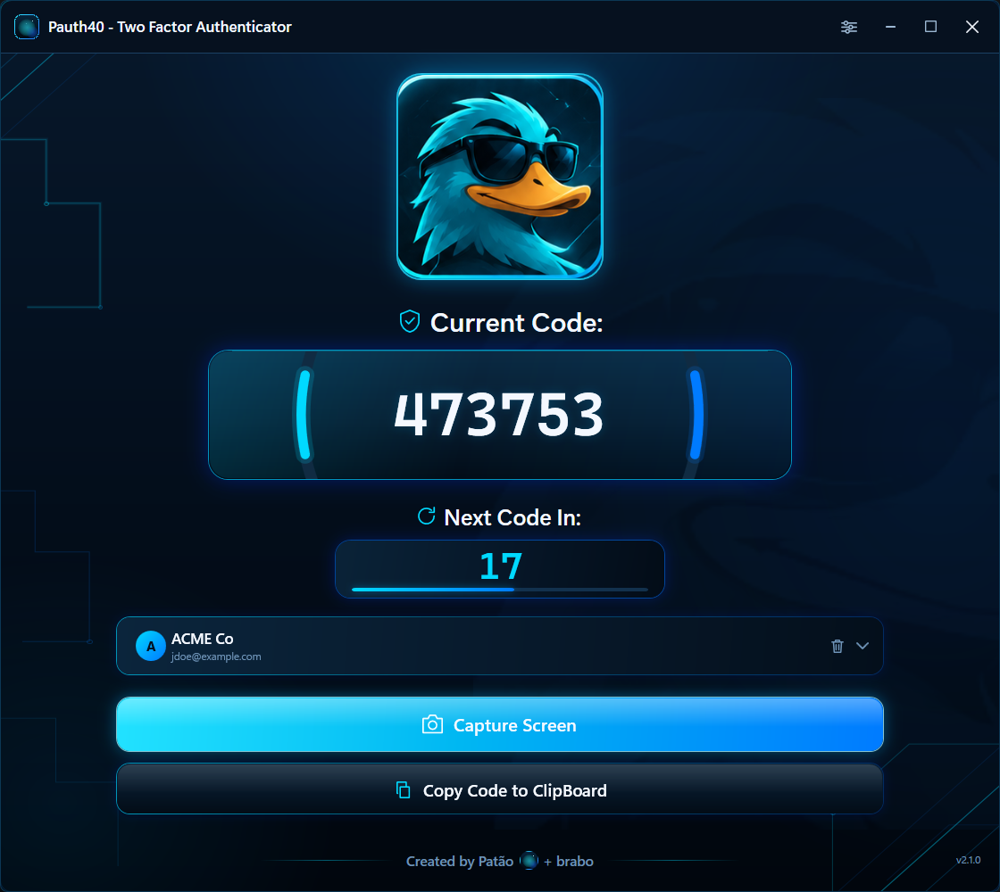
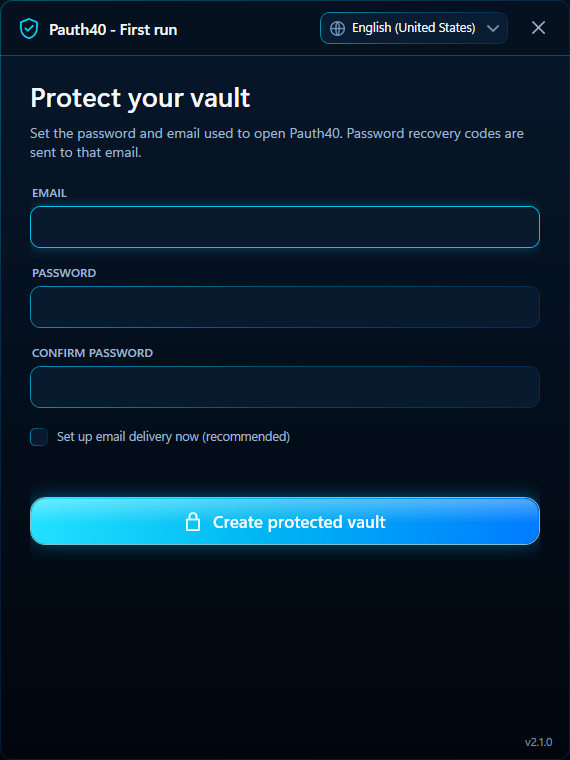
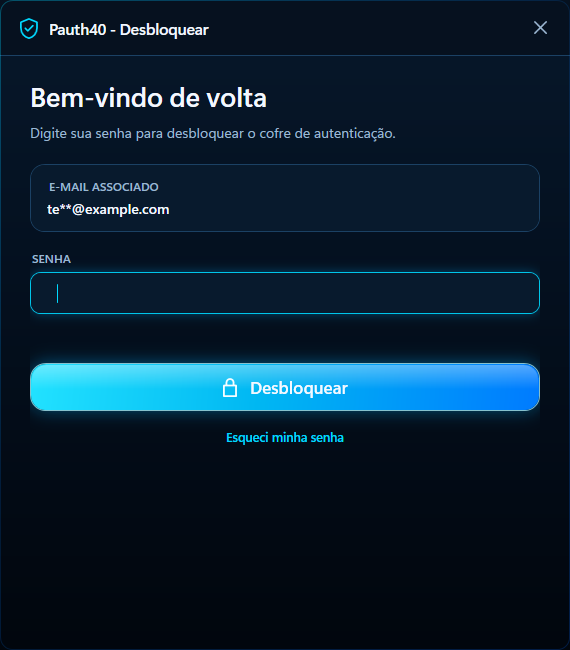
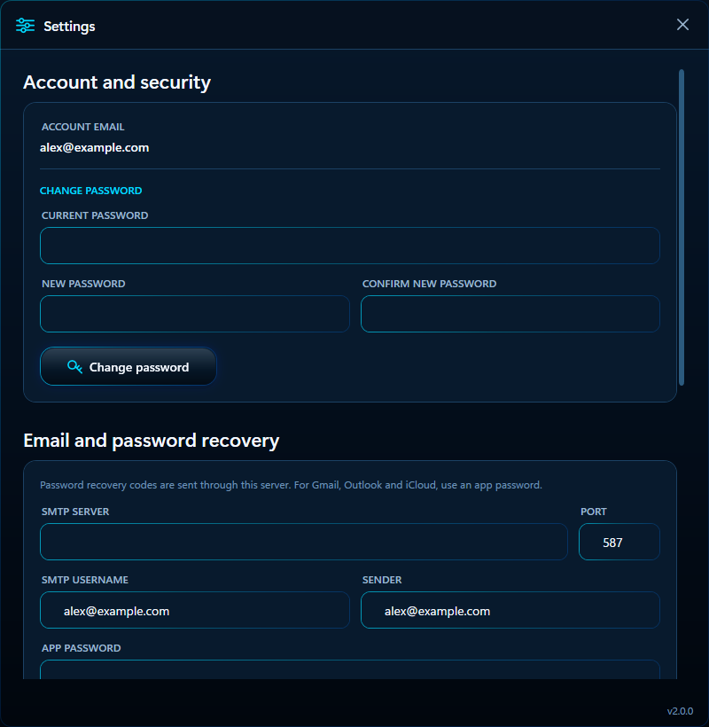

> [!WARNING]
> **ESTE PROJETO NÃO É OPEN SOURCE. NÃO ACEITAMOS O USO DO CÓDIGO PARA VERSÕES MODIFICADAS. QUALQUER AÇÃO SERÁ PUNÍVEL PELA LEI AO ABRIGO DA PROTEÇÃO DE PROPRIEDADE. O PROGRAMA É PATENTADO PELA PATAO.CLOUD.**
>
> **THIS PROJECT IS NOT OPEN SOURCE. WE DO NOT ACCEPT THE USE OF THE CODE FOR MODIFIED VERSIONS. ANY ACTION WILL BE PUNISHABLE BY LAW UNDER PROPERTY PROTECTION. THE PROGRAM IS PATENTED BY PATAO.CLOUD.**
>
> [LEGAL REFERENCES](#legal-protection)

# Pauth40 - Two Factor Authenticator

A local two-factor authenticator originally built with **WPF**, **.NET 8** and **MVVM**, and now ported to **Uno Platform** on **.NET 10**. The interface keeps the Pauth40 reference design: dark navy glass surfaces, cyan/blue lighting, circuit-line background, the Patão duck mascot, and a custom window chrome. The interface ships in **European Portuguese** and **US English**, and the community can add more languages by editing JSON files.



> **Uno Platform port (v2.2.0)** - the cross-platform sources live in [`linux/`](linux). The same project builds for **Windows, Linux, macOS, Android, iOS, tvOS and WebAssembly** while keeping the original WPF application in the repository root for reference. See [Platforms](#platforms) and [`linux/README.md`](linux/README.md).

## Platforms

| Platform | Target | Artifact |
| --- | --- | --- |
| Windows 10/11 | `net10.0-windows10.0.26100` (WinAppSDK) | `Pauth40-2.2.0-win-x64.exe` |
| Linux x64 | `net10.0-desktop` (Skia/X11) | `.AppImage` and portable `.tar.gz` |
| macOS (Intel/Apple Silicon) | `net10.0-desktop` (Skia) | `.app` bundle in a `.zip` |
| Android | `net10.0-android` | APK (built and signed per platform) |
| iOS | `net10.0-ios` | `.ipa` (requires an Apple developer certificate) |
| tvOS | `net10.0-tvos` | `.app` bundle (requires signing) |
| WebAssembly | `net10.0-browserwasm` | static web bundle in a `.zip` |

Download the ready-to-run builds from the [latest release](https://github.com/polimpo4/Pauth40/releases/latest). Mobile and Apple packages are produced from source with the platform SDKs; the compiled code is shared by every target.

## What it does

Pauth40 turns the `otpauth://` QR codes used by two-factor authentication into live **TOTP** codes on your desktop, phone or browser. Accounts are kept in a local vault protected by a master password and encrypted with **AES-256-GCM**; nothing is sent to a cloud service, and there is no telemetry. You can add accounts by capturing a QR code from the screen, by dragging QR image files onto the window, or by importing a legacy `novos` folder. The current code is always one click (or `Ctrl+C`) away.

- **Local and private** - the vault never leaves your computer; the only network requests are an optional recovery/test e-mail that you configure yourself and the read-only version check against the public GitHub releases feed.
- **Password + e-mail protected** - the app asks for the master password at startup and can recover access through a 6-digit e-mail code.
- **Portable backups** - export an encrypted `.pauth40` file and import it on another machine.
- **Community translations** - every interface and e-mail string comes from a JSON file in `langs`; choose the language at startup or in Settings.
- **Native WPF** - no Electron, no WebView, no embedded browser.

## Screenshots

| First run | Unlock |
| --- | --- |
|  |  |
| Define the master password and the recovery e-mail. | The associated e-mail is shown masked; recovery is one click away. |

Each security screen shows the language selector in the title bar, so the language can be changed before the vault is unlocked. The screenshots use US English; European Portuguese is the reference language.



Settings hold the password change, SMTP/e-mail recovery configuration, the language selector and the encrypted database export/import.

## Features

- Standard **TOTP** codes (SHA-1 / SHA-256 / SHA-512, 6-8 digits, custom periods).
- **Password-protected vault**: a master password and an associated e-mail are required at startup. Accounts are encrypted at rest with **AES-256-GCM** in the per-user application data folder (`%LOCALAPPDATA%\Pauth40\accounts.dat` on Windows, `~/.local/share/Pauth40/accounts.dat` on Linux and macOS).
- **E-mail password recovery**: a 6-digit code valid for 10 minutes can be sent to the associated e-mail through your own SMTP server; on Windows a local DPAPI recovery copy also allows a reset on the same Windows account, and on the other platforms a device-bound key allows the same local reset.
- **Encrypted database export/import**: create a password-protected `.pauth40` backup and merge it back on any machine without duplicating accounts.
- **Capture Screen** takes a screenshot, opens a dimmed selection overlay, scans the selected area with ZXing and imports the `otpauth://` account. On Windows it uses GDI, on Linux and macOS the native capture tools, and on mobile and WebAssembly the image picker.
- **Copy Code to ClipBoard** with clipboard retry handling and an inline confirmation state.
- Custom dark **account selector**; selection updates the code immediately.
- Account removal from the selector: the trash icon is always visible; click it twice within 6 seconds (or press `Delete` twice) to confirm.
- Drag and drop QR image files (`.png`, `.jpg`, `.bmp`, `.gif`, `.tif`) onto the window on Windows, Linux and macOS.
- Automatic, best-effort import of the original app's `novos\*.png` QR folder.
- **Settings page** (gear in the title bar): change the master password, configure/test SMTP, export and import the database.
- **Dynamic version footer and forced updates** - every screen shows the build version read from the assembly; on Windows and Linux, when a newer public GitHub release exists, a mandatory screen downloads it, replaces the executable/AppImage and relaunches the app.
- Resizable custom window: drag the title bar, double-click to maximize/restore, DPI-aware layout, Windows 11 rounded corners and dark DWM frame. On Linux and macOS the native window frame is used.

## Languages

The interface is translated at runtime from plain JSON files in [`langs`](langs). European Portuguese (`pt-PT`) is the reference language and US English (`en-US`) is the built-in fallback. A language file on disk overrides the embedded copy with the same `code`, so translations can be edited or added without rebuilding the app.

- On first run the app follows the operating system UI language: Portuguese Windows opens in `pt-PT`, other systems open in `en-US` when available.
- The language selector is in the header of the security screen (first-run setup, unlock and recovery) and in **Settings → Language**.
- Changing the language updates the interface immediately and is saved to `%LOCALAPPDATA%\Pauth40\language.json` (or `%PAUTH40_DATA_DIR%\language.json`, `~/.local/share/Pauth40/language.json` on Linux and macOS).
- Missing keys fall back to `pt-PT`, then `en-US`, so incomplete translations never show blank labels.
- Files are loaded from the embedded resources, from `langs` next to the executable, and from the per-user `langs` folder.

To add a language, copy `langs/en-US.json` to `langs/<code>.json` (for example `fr-FR.json`), translate the values and keep the keys and `{0}` placeholders unchanged. See [`langs/README.md`](langs/README.md) for the full translator guide and contribution workflow.

## Security

- TOTP secrets are never written to logs, telemetry or the network.
- The vault is encrypted with a random 256-bit vault key using **AES-256-GCM**. The vault key is wrapped by a key derived from the master password with **PBKDF2-SHA256 (310,000 iterations)** and a random salt.
- A second copy of the vault key is protected with **Windows DPAPI** (`CurrentUser`) on Windows, which enables password reset on the same Windows user. On the other platforms the copy is protected by a random AES-GCM key stored with owner-only permissions in the application data folder. That copy is what makes the local reset work; it does not exist on another computer or user account.
- Settings in `security.json` contain the password verifier, salt, wrapped vault key, local recovery blob and SMTP configuration. Passwords and SMTP app passwords are stored only in encrypted form, never in clear text.
- `accounts.dat` and `.pauth40` backups are authenticated with AES-GCM, so a wrong password or a modified file is rejected instead of silently returning corrupted data.
- No cloud services, no telemetry. The app works offline; the only request made without user action is the read-only version check against the public GitHub releases API, which sends no vault data and fails silently.
- The reference code (`994195`) and countdown are **not** hardcoded; every value comes from `Otp.NET` and the system clock.

## Build

### Uno Platform build (Windows, Linux, macOS, mobile and WebAssembly)

Requirements: [.NET SDK 10](https://dotnet.microsoft.com/download) and the workloads for the targets you need.

```powershell
dotnet workload install android ios tvos wasm-tools
```

The cross-platform project is [`linux/Pauth40/Pauth40.csproj`](linux/Pauth40/Pauth40.csproj) and targets `net10.0-android`, `net10.0-ios`, `net10.0-tvos`, `net10.0-windows10.0.26100`, `net10.0-browserwasm` and `net10.0-desktop`.

```powershell
# Windows
dotnet build .\linux\Pauth40\Pauth40.csproj -f net10.0-windows10.0.26100 -c Release

# Linux / macOS desktop (Skia)
dotnet build .\linux\Pauth40\Pauth40.csproj -f net10.0-desktop -c Release

# WebAssembly
dotnet build .\linux\Pauth40\Pauth40.csproj -f net10.0-browserwasm -c Release

# Android
dotnet build .\linux\Pauth40\Pauth40.csproj -f net10.0-android -c Release

# iOS / tvOS (requires a Mac for the final app bundle and signing)
dotnet build .\linux\Pauth40\Pauth40.csproj -f net10.0-ios -c Release
dotnet build .\linux\Pauth40\Pauth40.csproj -f net10.0-tvos -c Release
```

The Mac and Linux desktop runtimes are self-contained; the Android build needs the Android SDK (set `AndroidSdkDirectory` if it is not in the default location). See [`linux/README.md`](linux/README.md) for the platform notes, data locations and packaging details.

### Publish release artifacts

```powershell
# Windows host: Windows exe, Linux tarball and WebAssembly bundle in ..\dist
.\linux\publish.ps1
```

```bash
# Linux/macOS host: native tarball plus WebAssembly; set APPIMAGETOOL for an AppImage
cd linux
./publish.sh
```

On Linux the AppImage is the recommended package because the built-in updater replaces `.AppImage` files. The portable tarball ships with `install-linux.sh` and `uninstall-linux.sh`.

### WPF build (original Windows application)

Requirements: Windows 10/11, .NET SDK 8.0 or newer (the legacy project targets `net8.0-windows`).

```powershell
dotnet build .\Pauth40.csproj -c Release
```

```powershell
.\build.ps1 -Publish
```

The self-contained, single-file WPF executable is written to `dist\Pauth40.exe`.

## Version and updates

The version shown in the footer is read from the assembly metadata (`<Version>` in the project file), so it is never hardcoded. The current build is `2.2.0` and the footer displays `v2.2.0`. Both projects use the same version number.

On startup, after the security window is visible, Pauth40 queries the latest **public** GitHub release in the background:

```
https://api.github.com/repos/polimpo4/Pauth40/releases/latest
```

If the release tag (for example `v2.1.2`) is a higher semantic version than the installed one, a mandatory update window opens on top of the app. The user can update now or exit; the old build cannot continue to be used.

**Update now** downloads the first suitable asset from the release (`.exe` on Windows, `.AppImage` on Linux, preferring a file whose name contains `Pauth40`) and validates HTTPS/loopback, the advertised size, the `sha256:` digest when GitHub exposes one and the Windows `MZ` header. A hidden PowerShell helper then waits for Pauth40 to close, replaces the executable, relaunches the new build and deletes the temporary download. The app must be installed in a folder where the current user can write, and the executable must keep the name `Pauth40.exe` (or the AppImage must stay executable).

macOS, Android, iOS, tvOS and WebAssembly have no in-app updater; install the new release manually or through the platform store. The mandatory update screen is only used on Windows and Linux.

To publish an update:

1. Increase `<Version>` in both `Pauth40.csproj` (WPF) and `linux\Pauth40\Pauth40.csproj` (Uno) (for example to `2.2.1`).
2. Run `.\linux\publish.ps1` (Windows, Linux and WebAssembly) and, on Linux, `./linux/publish.sh` to produce the AppImage.
3. Create a GitHub release with the matching tag (`v2.2.1`), attach the `.exe`, `.AppImage`, tarball, macOS zips and WASM zip, and publish it. The release body is shown as release notes in the update screen. The `Release` workflow does the same when it is started manually from **Actions > Release > Run workflow** with the tag name.
4. Do not mark the release as a draft or pre-release; the updater ignores both.

Release notes can be written in both languages. Put each translation after a standalone `[pt-PT]` or `[en-US]` marker line; the update window shows only the section that matches the interface language, falling back to `pt-PT`, then `en-US`, then the first section. A release body without markers is shown as-is.

```text
[pt-PT]
Novidades da versão...

[en-US]
What's new in this release...
```

The repository and its releases must be publicly readable for anonymous update checks. For a private repository, set `PAUTH40_GITHUB_TOKEN` before starting the app, or point `PAUTH40_UPDATE_URL` at a GitHub-compatible JSON feed. `PAUTH40_SKIP_UPDATE_CHECK=1` disables the startup check, which is useful for offline testing.

## Usage

### First launch

1. Start Pauth40 (`Pauth40.exe` on Windows, the AppImage or the installed `pauth40` launcher on Linux, `Pauth40.app` on macOS). Use the language selector in the header to change the interface language.
2. On the **Protect your vault** screen (`Proteja o seu cofre` in Portuguese), enter the e-mail that will receive password-recovery codes, then define and confirm a master password (minimum 8 characters).
3. Optionally enable **Set up email delivery now** and fill in your SMTP server, port, user and app password. Provider defaults are filled automatically for Gmail, Outlook, Yahoo, iCloud, Zoho and GMX. You can also do this later in **Settings**.
4. Click **Create protected vault**. An existing legacy DPAPI vault is migrated automatically and a `accounts.dat.legacy.bak` copy is kept.

### Daily use

1. Start the app and enter your master password on the unlock screen. The associated e-mail is shown masked.
2. Click **Capture Screen**, drag a rectangle around the QR code, and release.
3. The account is added, encrypted and selected. The current code and countdown update automatically.
4. Use **Copy Code to ClipBoard** (or `Ctrl+C`) to copy the visible code.
5. Use the selector to switch accounts. Click the trash icon twice within 6 seconds to remove the selected account (or press `Delete` twice).

### Settings

Open the gear icon in the header to:

- change the master password (current password + new password confirmation);
- configure the SMTP server and send a test e-mail;
- switch the interface language;
- export a password-protected `.pauth40` backup, or import one and merge its accounts.

### Forgot the password

On the unlock screen click **I forgot my password** (`Esqueci a minha senha`):

- **E-mail code** - send a 6-digit code to the associated address (valid for 10 minutes, at most 5 attempts), enter it and define a new password. If no SMTP server is saved yet, the reset screen lets you configure one inline.
- **Reset using this device** - use the local recovery copy to define a new password without e-mail. On Windows this is the DPAPI copy of the vault key; on Linux, macOS, Android, iOS, tvOS and WebAssembly it is a device-bound AES-GCM key. It works only on the same device and user that created the vault; on another device, use the e-mail code instead.

### Importing QR image files

Drag one or more QR screenshots onto the window. Legacy `novos` folders are scanned at startup from the current directory, the executable directory and `%LOCALAPPDATA%\Pauth40\novos`.

### Migrating from the original Pauth40

The original app stored its QR screenshots in a `novos` folder beside its executable. Copy those `.png` files into any of these locations:

- `%LOCALAPPDATA%\Pauth40\novos` (Windows) or `~/.local/share/Pauth40/novos` (Linux/macOS)
- a `novos` folder next to the executable
- a `novos` folder in the current working directory

On startup the app decodes every valid `otpauth://` QR, imports the account and ignores duplicates. If the vault is still the old DPAPI format, the first password setup migrates it to the encrypted keyed format. The source images are never modified. Dragging the same `.png` files onto the window performs the same import immediately.

### Preview rendering (development)

```powershell
Pauth40.exe --render C:\temp\preview.png
```

This starts a temporary in-memory demo vault, renders the real WPF visual tree to a PNG and exits. It never reads or writes the user's account vault.

Set the `PAUTH40_DATA_DIR` environment variable to point the app at an isolated data folder, useful for testing without touching the real profile.

## Project layout

```
Pauth40.csproj                   original WPF application (net8.0-windows)
App.xaml / App.xaml.cs           DI bootstrap, security gate and --render mode
MainWindow.xaml / .cs            window chrome, layout, background, interaction
ViewModels\MainViewModel.cs      accounts, TOTP timer, capture/copy/import commands
Views\SecurityWindow.*           first-run setup, unlock and password recovery
Views\SettingsWindow.*           password, SMTP and encrypted database settings
Views\CaptureOverlayWindow.*     full-screen QR selection overlay
Views\UpdateWindow.*             mandatory update prompt, progress and retry
Controls\CircularCountdown.cs    twin TOTP arcs
Services\                        clipboard, capture, e-mail, commands
Services\UpdateService.cs        GitHub release check, verified download and self-update
AppVersion.cs                    dynamic version read from assembly metadata
SemanticVersion.cs               SemVer parsing and comparison
Themes\PauthTheme.xaml           palette, brushes, control templates
Localization\                    loader, XAML markup extension and Loc helpers
langs\                           pt-PT / en-US JSON translations + translator guide
Account.cs                       account model
AccountStore.cs                  AES-GCM keyed vault + legacy DPAPI migration
SecurityService.cs               password verifier, key wrapping, DPAPI reset, SMTP, backups
AppPaths.cs                      data-folder resolution (supports PAUTH40_DATA_DIR)
TotpService.cs / OtpAuthParser.cs / QrDecoder.cs
Assets\                          duck mascot and app icon
docs\screenshots\                interface screenshots used by this README
docs\releases\                   release notes per version (bilingual)

linux\                           Uno Platform port (net10.0, all platforms)
  Pauth40.sln                    cross-platform solution
  Directory.Packages.props       centralized NuGet versions
  Pauth40\Pauth40.csproj         single project with all target frameworks
  Pauth40\App.xaml(.cs)          DI bootstrap and window creation
  Pauth40\MainPage.xaml(.cs)     single-window shell and navigation
  Pauth40\Views\*                Security, Main, Settings, Update and Capture views
  Pauth40\ViewModels\            shared TOTP view model
  Pauth40\Services\              clipboard, capture, pickers, updates, release notes
  Pauth40\Themes\PauthTheme.xaml palette, styles and icon geometries
  Pauth40\Platforms\             Android, iOS, tvOS, desktop and WASM entry points
  Pauth40.desktop                Linux desktop entry
  install-linux.sh               per-user Linux installer
  uninstall-linux.sh             per-user Linux uninstaller
  publish.sh / publish.ps1       release artifacts for Linux/macOS/Windows/WASM
  README.md                      Uno build, packaging and platform notes
```

## Legal protection

Legal references supporting the protection of this software at international and national level. Each entry links to the official text of the applicable law; the specific articles must be confirmed case by case.

> **To be validated by a lawyer.** This section is a reference index. The links point to official legal texts, but the legal qualification of each use, the exact articles and the scope of protection must be confirmed by a lawyer before any action.

<!-- Format: **Country (native name):** [Law](official link) — scope of protection. -->

### International

- **International conventions and treaties:** [Berne Convention for the Protection of Literary and Artistic Works](https://www.wipo.int/treaties/en/ip/berne/) — literary and artistic works, including computer programs.
- **WIPO:** [WIPO Copyright Treaty (WCT)](https://www.wipo.int/treaties/en/ip/wct/) — protection of computer programs and databases.
- **WIPO:** [Paris Convention for the Protection of Industrial Property](https://www.wipo.int/treaties/en/ip/paris/) — patents, trademarks and industrial property.
- **WIPO:** [Patent Cooperation Treaty (PCT)](https://www.wipo.int/pct/en/) — international patent applications.
- **TRIPS Agreement / WTO:** [Agreement on Trade-Related Aspects of Intellectual Property Rights](https://www.wto.org/english/docs_e/legal_e/27-trips_01_e.htm) — minimum standards of intellectual property protection.

### Europe

- **European Union:** [Directive 2009/24/EC on the legal protection of computer programs](https://eur-lex.europa.eu/legal-content/EN/TXT/?uri=CELEX:32009L0024) — software protection and prohibition of unauthorised copying.
- **Portugal:** [Code of Copyright and Related Rights (Decree-Law No. 63/85)](https://diariodarepublica.pt/dr/legislacao-consolidada/decreto-lei/1985-34444375) — copyright and related rights.
- **Portugal:** [Industrial Property Code](https://www.wipo.int/wipolex/en/legislation/details/21381) — patents, trademarks and unfair competition.
- **España:** [Consolidated Text of the Intellectual Property Law](https://www.boe.es/buscar/act.php?id=BOE-A-1996-8930) — intellectual property.
- **España:** [Patents Act (Law 24/2015)](https://www.boe.es/buscar/act.php?id=BOE-A-2015-8328) — patents and inventions.
- **France:** [Intellectual Property Code](https://www.wipo.int/wipolex/en/legislation/details/23227) — copyright, patents and industrial property.
- **Deutschland:** [Copyright Act (UrhG)](https://www.gesetze-im-internet.de/urhg/) — copyright and related rights.
- **Deutschland:** [Patent Act (PatG)](https://www.gesetze-im-internet.de/patg/) — patents and inventions.
- **United Kingdom:** [Copyright, Designs and Patents Act 1988](https://www.legislation.gov.uk/ukpga/1988/48/contents) — copyright, designs and patents.
- **United Kingdom:** [Patents Act 1977](https://www.legislation.gov.uk/ukpga/1977/37/contents) — patents and inventions.

### North America

- **United States:** [Copyright Law, Title 17 of the U.S. Code](https://www.copyright.gov/title17/) — copyright, including software.
- **United States:** [Patent Law, Title 35 of the U.S. Code](https://www.govinfo.gov/app/details/USCODE-2023-title35) — patents and inventions.
- **Canada:** [Copyright Act (R.S.C., 1985, c. C-42)](https://laws-lois.justice.gc.ca/eng/acts/C-42/) — copyright.
- **Canada:** [Patent Act (R.S.C., 1985, c. P-4)](https://laws-lois.justice.gc.ca/eng/acts/P-4/) — patents.
- **México:** [Federal Law on Copyright](https://www.wipo.int/wipolex/en/legislation/details/23966) — copyright and related rights.
- **México:** [Federal Law on the Protection of Industrial Property](https://www.wipo.int/wipolex/en/legislation/details/23961) — patents, trademarks and industrial property.

### South America

- **Brasil:** [Law No. 9,610/1998 — Copyright](https://www.planalto.gov.br/ccivil_03/leis/l9610.htm) — copyright and related rights.
- **Brasil:** [Law No. 9,279/1996 — Industrial Property](https://www.planalto.gov.br/ccivil_03/leis/l9279.htm) — patents, trademarks and unfair competition.
- **Brasil:** [Law No. 9,609/1998 — Protection of Intellectual Property of Computer Programs](https://www.planalto.gov.br/ccivil_03/leis/l9609.htm) — legal protection of software.
- **Argentina:** [Intellectual Property Law (Law 11,723)](https://www.wipo.int/wipolex/en/legislation/details/21169) — intellectual property.
- **Argentina:** [Patents for Inventions and Utility Models Law (Law 24,481)](https://www.wipo.int/wipolex/en/legislation/details/21176) — patents and inventions.
- **Chile:** [Law No. 17,336 on Intellectual Property](https://www.bcn.cl/leychile/navegar?idNorma=28933) — intellectual property.
- **Chile:** [Law No. 19,039 on Industrial Property](https://www.bcn.cl/leychile/navegar?idNorma=30608) — patents, trademarks and industrial property.

### Asia

- **中国 (China):** [Copyright Law of the People's Republic of China](https://www.wipo.int/wipolex/en/legislation/details/21065) — copyright and related rights.
- **中国 (China):** [Patent Law of the People's Republic of China](https://www.wipo.int/wipolex/en/legislation/details/21027) — patents and inventions.
- **中国 (China):** [Regulations on the Protection of Computer Software](https://www.wipo.int/wipolex/en/legislation/details/13396) — legal protection of software.
- **日本 (Japan):** [Copyright Act](https://elaws.e-gov.go.jp/document?lawid=345AC0000000048) — copyright and related rights.
- **日本 (Japan):** [Patent Act](https://elaws.e-gov.go.jp/document?lawid=334AC0000000121) — patents and inventions.
- **भारत (India):** [Copyright Act, 1957](https://www.wipo.int/wipolex/en/legislation/details/22949) — copyright and related rights.
- **भारत (India):** [Patents Act, 1970](https://www.wipo.int/wipolex/en/legislation/details/22960) — patents and inventions.
- **대한민국 (South Korea):** [Copyright Act](https://www.wipo.int/wipolex/en/legislation/details/23632) — copyright and related rights.
- **대한민국 (South Korea):** [Patent Act](https://www.wipo.int/wipolex/en/legislation/details/23642) — patents and inventions.

### Africa

- **South Africa / Suid-Afrika:** [Copyright Act 98 of 1978](https://www.wipo.int/wipolex/en/legislation/details/4067) — copyright and related rights.
- **South Africa / Suid-Afrika:** [Patents Act 57 of 1978](https://www.wipo.int/wipolex/en/legislation/details/6256) — patents and inventions.
- **Angola:** [Law No. 15/14 of 31 July — Copyright and Related Rights](https://www.wipo.int/wipolex/en/legislation/details/18642) — copyright and related rights.
- **Angola:** [Law No. 3/92 of 28 February — Industrial Property](https://www.wipo.int/wipolex/en/legislation/details/5667) — industrial property.
- **Moçambique:** [Law No. 9/2022 of 29 June — Copyright and Related Rights](https://www.wipo.int/wipolex/en/legislation/details/21426) — copyright and related rights.
- **Moçambique:** [Industrial Property Code (Decree No. 47/2015)](https://www.wipo.int/wipolex/en/legislation/details/16076) — industrial property.
- **Cabo Verde:** [Decree-Law No. 1/2009 of 27 April — Copyright and Related Rights](https://www.wipo.int/wipolex/en/legislation/details/8227) — copyright and related rights.
- **Cabo Verde:** [Industrial Property Code](https://www.wipo.int/wipolex/en/legislation/details/6422) — industrial property.
- **Nigeria:** [Copyright Act](https://www.wipo.int/wipolex/en/legislation/details/21820) — copyright and related rights.
- **Nigeria:** [Patents and Designs Act](https://www.wipo.int/wipolex/en/legislation/details/5414) — patents and designs.

### Oceania

- **Australia:** [Copyright Act 1968](https://www.legislation.gov.au/C1968A00063/latest/text) — copyright and related rights.
- **Australia:** [Patents Act 1990](https://www.legislation.gov.au/C2004A04060/latest/text) — patents and inventions.
- **New Zealand / Aotearoa:** [Copyright Act 1994](https://www.legislation.govt.nz/act/public/1994/0143/latest/DLM345634.html) — copyright and related rights.
- **New Zealand / Aotearoa:** [Patents Act 2013](https://www.legislation.govt.nz/act/public/2013/0068/latest/DLM5483400.html) — patents and inventions.
