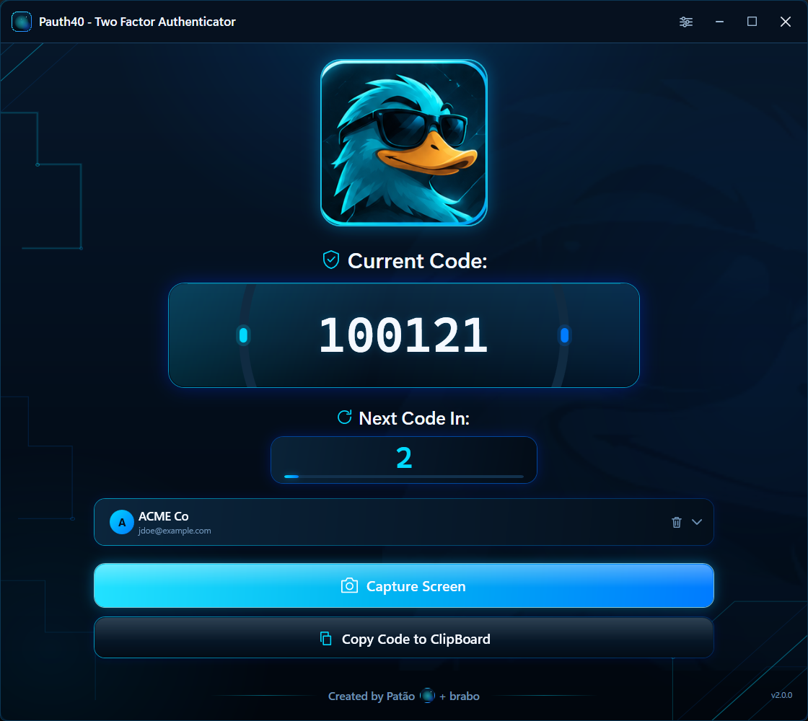
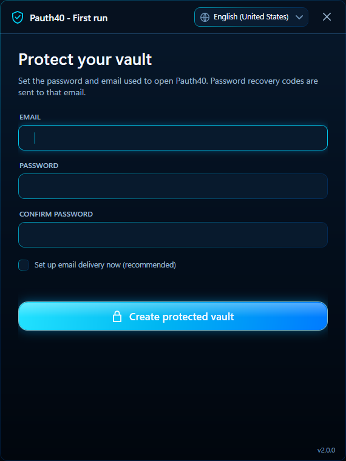
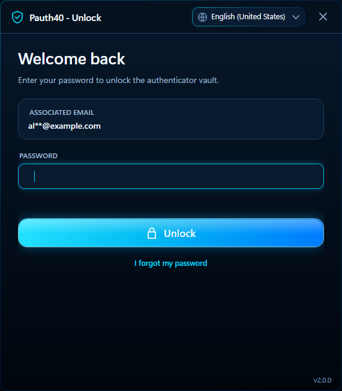
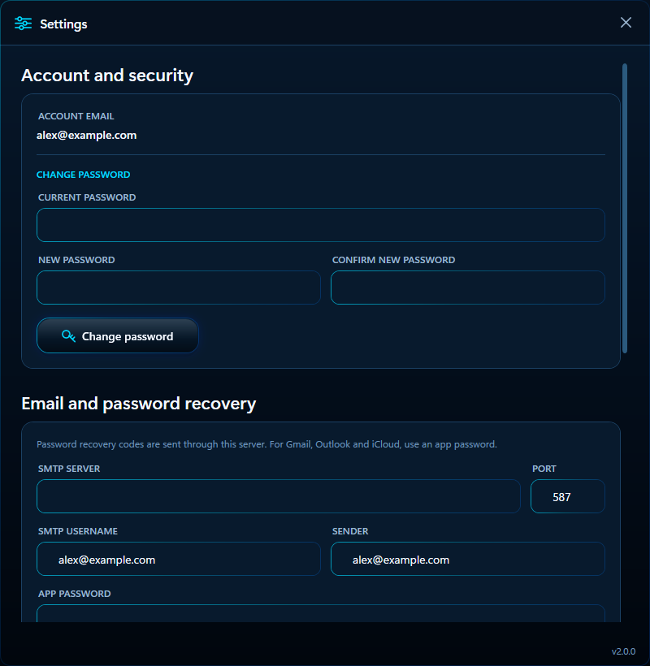

# Pauth40 - Two Factor Authenticator

A native Windows 11 two-factor authenticator built with **WPF**, **.NET 8**, **XAML** and **MVVM**. The interface is a full reconstruction of the Pauth40 reference design: dark navy glass surfaces, cyan/blue lighting, circuit-line background, the Patão duck mascot, and a custom window chrome. The interface ships in **European Portuguese** and **US English**, and the community can add more languages by editing JSON files.



## What it does

Pauth40 turns the `otpauth://` QR codes used by two-factor authentication into live **TOTP** codes on your Windows desktop. Accounts are kept in a local vault protected by a master password and encrypted with **AES-256-GCM**; nothing is sent to a cloud service, and there is no telemetry. You can add accounts by capturing a QR code from the screen, by dragging QR image files onto the window, or by importing a legacy `novos` folder. The current code is always one click (or `Ctrl+C`) away.

- **Local and private** - the vault never leaves your computer; the only network requests are an optional recovery/test e-mail that you configure yourself and the read-only version check against the public GitHub releases feed.
- **Password + e-mail protected** - the app asks for the master password at startup and can recover access through a 6-digit e-mail code.
- **Portable backups** - export an encrypted `.pauth40` file and import it on another machine.
- **Community translations** - every interface and e-mail string comes from a JSON file in `langs`; choose the language at startup or in Settings.
- **Native WPF** - no Electron, no WebView, no embedded browser.

## Screenshots

| First run | Unlock |
| --- | --- |
|  |  |
| Define the master password and the recovery e-mail. | The associated e-mail is shown masked; recovery is one click away. |

Each security screen shows the language selector in the title bar, so the language can be changed before the vault is unlocked. The screenshots use US English; European Portuguese is the reference language.



Settings hold the password change, SMTP/e-mail recovery configuration, the language selector and the encrypted database export/import.

## Features

- Standard **TOTP** codes (SHA-1 / SHA-256 / SHA-512, 6-8 digits, custom periods).
- **Password-protected vault**: a master password and an associated e-mail are required at startup. Accounts are encrypted at rest with **AES-256-GCM** in `%LOCALAPPDATA%\Pauth40\accounts.dat`.
- **E-mail password recovery**: a 6-digit code valid for 10 minutes can be sent to the associated e-mail through your own SMTP server; a local Windows recovery copy also allows a reset on the same Windows account.
- **Encrypted database export/import**: create a password-protected `.pauth40` backup and merge it back on any machine without duplicating accounts.
- **Capture Screen** takes a screenshot, opens a dimmed selection overlay, scans the selected area with ZXing and imports the `otpauth://` account.
- **Copy Code to ClipBoard** with clipboard retry handling and an inline confirmation state.
- Custom dark **account selector**; selection updates the code immediately.
- Account removal from the selector: the trash icon is always visible; click it twice within 6 seconds (or press `Delete` twice) to confirm.
- Drag and drop QR image files (`.png`, `.jpg`, `.bmp`, `.gif`, `.tif`) onto the window.
- Automatic, best-effort import of the original app's `novos\*.png` QR folder.
- **Settings window** (gear in the title bar): change the master password, configure/test SMTP, export and import the database.
- **Dynamic version footer and forced updates** - every window shows the build version read from the assembly; when a newer public GitHub release exists, a mandatory window downloads it, replaces the executable and relaunches the app.
- Resizable custom window: drag the title bar, double-click to maximize/restore, DPI-aware layout, Windows 11 rounded corners and dark DWM frame.

## Languages

The interface is translated at runtime from plain JSON files in [`langs`](langs). European Portuguese (`pt-PT`) is the reference language and US English (`en-US`) is the built-in fallback. A language file on disk overrides the embedded copy with the same `code`, so translations can be edited or added without rebuilding the app.

- On first run the app follows the Windows UI language: Portuguese Windows opens in `pt-PT`, other systems open in `en-US` when available.
- The language selector is in the title bar of the security screen (first-run setup, unlock and recovery) and in **Settings → Language**.
- Changing the language updates every open window immediately and is saved to `%LOCALAPPDATA%\Pauth40\language.json` (or `%PAUTH40_DATA_DIR%\language.json`).
- Missing keys fall back to `pt-PT`, then `en-US`, so incomplete translations never show blank labels.
- Files are loaded from the embedded resources, from `langs` next to `Pauth40.exe`, and from `%LOCALAPPDATA%\Pauth40\langs`.

To add a language, copy `langs/en-US.json` to `langs/<code>.json` (for example `fr-FR.json`), translate the values and keep the keys and `{0}` placeholders unchanged. See [`langs/README.md`](langs/README.md) for the full translator guide and contribution workflow.

## Security

- TOTP secrets are never written to logs, telemetry or the network.
- The vault is encrypted with a random 256-bit vault key using **AES-256-GCM**. The vault key is wrapped by a key derived from the master password with **PBKDF2-SHA256 (310,000 iterations)** and a random salt.
- A second copy of the vault key is protected with **Windows DPAPI** (`CurrentUser`), which enables password reset on the same Windows user. That copy is what makes the local reset work; it does not exist on another computer or Windows account.
- Settings in `security.json` contain the password verifier, salt, wrapped vault key, DPAPI recovery blob and SMTP configuration. Passwords and SMTP app passwords are stored only in encrypted form, never in clear text.
- `accounts.dat` and `.pauth40` backups are authenticated with AES-GCM, so a wrong password or a modified file is rejected instead of silently returning corrupted data.
- No cloud services, no telemetry. The app works offline; the only request made without user action is the read-only version check against the public GitHub releases API, which sends no vault data and fails silently.
- The reference code (`994195`) and countdown are **not** hardcoded; every value comes from `Otp.NET` and the system clock.

## Build

Requirements: Windows 10/11, .NET SDK 8.0 or newer (the project targets `net8.0-windows`).

```powershell
dotnet build .\Pauth40.csproj -c Release
```

## Publish a single executable

```powershell
.\build.ps1 -Publish
```

The self-contained, single-file executable is written to `dist\Pauth40.exe`.

## Version and updates

The version shown in the footer of every window is read from the assembly metadata (`<Version>` in `Pauth40.csproj`), so it is never hardcoded. The current build is `2.0.0` and the footer displays `v2.0.0`.

On startup, after the security window is visible, Pauth40 queries the latest **public** GitHub release in the background:

```
https://api.github.com/repos/polimpo4/Pauth40/releases/latest
```

If the release tag (for example `v2.1.0`) is a higher semantic version than the installed one, a mandatory update window opens on top of the app. The user can update now or exit; the old build cannot continue to be used.

**Update now** downloads the first `.exe` asset from the release (preferring a file whose name contains `Pauth40`) and validates HTTPS/loopback, the advertised size, the `sha256:` digest when GitHub exposes one and the Windows `MZ` header. A hidden PowerShell helper then waits for Pauth40 to close, replaces `Pauth40.exe`, relaunches the new build and deletes the temporary download. The app must be installed in a folder where the current user can write, and the executable must keep the name `Pauth40.exe`.

To publish an update:

1. Increase `<Version>` in `Pauth40.csproj` (for example to `2.1.0`).
2. Run `.\build.ps1 -Publish`.
3. Create a GitHub release with the matching tag (`v2.1.0`), attach `dist\Pauth40.exe` as an asset and publish it. The release body is shown as release notes in the update window.
4. Do not mark the release as a draft or pre-release; the updater ignores both.

The repository and its releases must be publicly readable for anonymous update checks. For a private repository, set `PAUTH40_GITHUB_TOKEN` before starting the app, or point `PAUTH40_UPDATE_URL` at a GitHub-compatible JSON feed. `PAUTH40_SKIP_UPDATE_CHECK=1` disables the startup check, which is useful for offline testing.

## Usage

### First launch

1. Start `Pauth40.exe`. Use the language selector in the title bar to change the interface language.
2. On the **Protect your vault** screen (`Proteja o seu cofre` in Portuguese), enter the e-mail that will receive password-recovery codes, then define and confirm a master password (minimum 8 characters).
3. Optionally enable **Set up email delivery now** and fill in your SMTP server, port, user and app password. Provider defaults are filled automatically for Gmail, Outlook, Yahoo, iCloud, Zoho and GMX. You can also do this later in **Settings**.
4. Click **Create protected vault**. An existing legacy DPAPI vault is migrated automatically and a `accounts.dat.legacy.bak` copy is kept.

### Daily use

1. Start the app and enter your master password on the unlock screen. The associated e-mail is shown masked.
2. Click **Capture Screen**, drag a rectangle around the QR code, and release.
3. The account is added, encrypted and selected. The current code and countdown update automatically.
4. Use **Copy Code to ClipBoard** (or `Ctrl+C`) to copy the visible code.
5. Use the selector to switch accounts. Click the trash icon twice within 6 seconds to remove the selected account (or press `Delete` twice).

### Settings

Open the gear icon in the title bar to:

- change the master password (current password + new password confirmation);
- configure the SMTP server and send a test e-mail;
- switch the interface language;
- export a password-protected `.pauth40` backup, or import one and merge its accounts.

### Forgot the password

On the unlock screen click **I forgot my password** (`Esqueci a minha senha`):

- **E-mail code** - send a 6-digit code to the associated address (valid for 10 minutes, at most 5 attempts), enter it and define a new password. If no SMTP server is saved yet, the reset screen lets you configure one inline.
- **Reset using this Windows account** - use the DPAPI recovery copy to define a new password without e-mail. This works only on the same Windows user that created the vault; on another computer or user account, use the e-mail code instead.

### Importing QR image files

Drag one or more QR screenshots onto the window. Legacy `novos` folders are scanned at startup from the current directory, the executable directory and `%LOCALAPPDATA%\Pauth40\novos`.

### Migrating from the original Pauth40

The original app stored its QR screenshots in a `novos` folder beside its executable. Copy those `.png` files into any of these locations:

- `%LOCALAPPDATA%\Pauth40\novos`
- a `novos` folder next to the new `Pauth40.exe`
- a `novos` folder in the current working directory

On startup the app decodes every valid `otpauth://` QR, imports the account and ignores duplicates. If the vault is still the old DPAPI format, the first password setup migrates it to the encrypted keyed format. The source images are never modified. Dragging the same `.png` files onto the window performs the same import immediately.

### Preview rendering (development)

```powershell
Pauth40.exe --render C:\temp\preview.png
```

This starts a temporary in-memory demo vault, renders the real WPF visual tree to a PNG and exits. It never reads or writes the user's account vault.

Set the `PAUTH40_DATA_DIR` environment variable to point the app at an isolated data folder, useful for testing without touching the real profile.

## Project layout

```
Pauth40.csproj
App.xaml / App.xaml.cs          DI bootstrap, security gate and --render mode
MainWindow.xaml / .cs           window chrome, layout, background, interaction
ViewModels\MainViewModel.cs     accounts, TOTP timer, capture/copy/import commands
Views\SecurityWindow.*          first-run setup, unlock and password recovery
Views\SettingsWindow.*          password, SMTP and encrypted database settings
Views\CaptureOverlayWindow.*    full-screen QR selection overlay
Views\UpdateWindow.*            mandatory update prompt, progress and retry
Controls\CircularCountdown.cs   twin TOTP arcs
Services\                       clipboard, capture, e-mail, commands
Services\UpdateService.cs       GitHub release check, verified download and self-update
AppVersion.cs                   dynamic version read from assembly metadata
SemanticVersion.cs              SemVer parsing and comparison
Themes\PauthTheme.xaml          palette, brushes, control templates
Localization\                   loader, XAML markup extension and Loc helpers
langs\                          pt-PT / en-US JSON translations + translator guide
Account.cs                      account model
AccountStore.cs                 AES-GCM keyed vault + legacy DPAPI migration
SecurityService.cs              password verifier, key wrapping, DPAPI reset, SMTP, backups
AppPaths.cs                     data-folder resolution (supports PAUTH40_DATA_DIR)
TotpService.cs / OtpAuthParser.cs / QrDecoder.cs
Assets\                         duck mascot and app icon
docs\screenshots\               interface screenshots used by this README
preview.png                     Latest --render output of the demo vault
```
